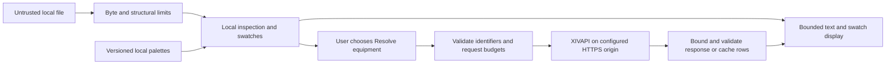

# Security design review: ffxiv-chara MVP

**Status (updated 2026-10-23):** the library this model covers is published as npm betas and the static demo is deployed ([Cloudflare hosting](../cloudflare-hosting.md)). The original design review was against documentation commit `e426278c2c70664f4a6579c0d9553d01743d83d3`; its scope and historical observations below remain the review record, and the gap and acceptance tables are the original requirements, not a list of what remains. Evidence is recorded in [reader validation](reader-validation.md), [palette/appearance validation](appearance-validation.md), [XIVAPI validation](xivapi-validation.md), [distribution validation](distribution-validation.md) and [implementation progress](../implementation-progress.md). Gates whose tests are weaker than their wording, notably SEC-03 and SEC-05, are listed in the [2026-10-23 audit](../audit-2026-10-23.md). This is not a security certification.

This document supplements the [implementation plan](../plans/2026-10-19-chara-library-mvp.md). Its proposed controls and numerical defaults must be resolved in Task 0 and verified during the corresponding implementation tasks. Security work is part of those tasks, not a final scan after the MVP is built.

## Scope and review record

The review covers the public reader/inspection API, appearance swatches, bundled palettes, optional XIVAPI adapter, static reference website, public fixtures, and eventual package/build pipeline. It used the repository's two initial documents, an independent read-only design review, and the primary sources linked below. At the original planning review, dependency scans, exploit tests, runtime benchmarks, and live browser/network checks were not run because the implementation did not exist. Subsequent implementation evidence is recorded in [implementation progress](../implementation-progress.md), including the [demo's browser/privacy and live-integration checks](../demo.md). Hosted CI and installed-runtime acceptance are recorded in [distribution validation](distribution-validation.md), and the deployed-origin response headers were checked on 2026-10-22 ([Cloudflare hosting](../cloudflare-hosting.md#deployment-verified-on-2026-10-22)). Browsers and runtimes beyond that matrix, and the deployed origin after any later deployment, remain open.

There is no account system, database, file-upload backend, arbitrary URL importer, game-plugin execution, or `.chara` writer in the proposed MVP. Adding any of these, a proxy, persistent character sharing, or automatic remote enrichment requires revisiting this model. Server-side consumers of the library have additional responsibilities even though the demo is static.

## Assets, attackers, and trust boundaries

Protect character-file contents and metadata, the user's browser responsiveness, a consuming server's availability and network access, correct inspection/results, and the integrity of public source and release artifacts.

An attacker can share a crafted `.chara` file, influence an upstream response or cache record, or submit a public repository contribution. File names, extensions, MIME types, producer labels, every JSON key/value, and XIVAPI/cache contents are untrusted. Maintainer-selected code, endpoint configuration, injected fetch/cache/provider functions, and locked build inputs form separate trust boundaries. Injected JavaScript functions already execute with the host's privileges; this library cannot sandbox them.

**Proposed privacy behavior:** selecting a file performs local inspection and swatch resolution only. A clearly labelled **Resolve equipment** action starts the optional lookup for that file, including icons. Replacing the file resets this choice. Page assets and bundled palettes may load from the website's own origin; this is distinct from character-dependent outbound requests.

The explicit lookup sends model/slot identifiers, facewear ID and, for optional name resolution, validated Stain IDs, plus necessary version, schema, locale, fields and pagination parameters. It excludes file contents/name, producer metadata, character/author/nickname and unrelated appearance values. Equipment/dye combinations may still be distinctive, and XIVAPI/the connection infrastructure receives normal request metadata such as the visitor's IP address. The site host receives ordinary page/asset requests. Promise **local file processing with optional identifier lookup**, not anonymity or that no data ever leaves the device. Explain this before the lookup action; exclude character data from analytics, crash reports, CSP reports, console output, URLs, and storage.

## Design gaps and ownership

Evidence links refer to the initial plan, before this review's amendments. Priorities describe when a requirement must be addressed, not vulnerability severity.

| ID | Gap and exposure | Baseline evidence | Required task |
|---|---|---|---|
| SEC-01 | An iterative walk after JSON parsing cannot prevent the parse's earlier allocation/work; large allowed scalars can also overwhelm diagnostics or rendering. A shared file can trigger this. | [Input defaults](https://github.com/FlashGalatine/ffxiv-chara/blob/e426278c2c70664f4a6579c0d9553d01743d83d3/docs/plans/2026-10-19-chara-library-mvp.md#L46), [reader](https://github.com/FlashGalatine/ffxiv-chara/blob/e426278c2c70664f4a6579c0d9553d01743d83d3/docs/plans/2026-10-19-chara-library-mvp.md#L151) | 0–2, 7: before accepting user files |
| SEC-02 | “Sanitized” unknown fields and image removal lack a precise contract; downstream merges, coercion, and producer-based dispatch could give data unintended authority. | [Document contract](https://github.com/FlashGalatine/ffxiv-chara/blob/e426278c2c70664f4a6579c0d9553d01743d83d3/docs/plans/2026-10-19-chara-library-mvp.md#L118) | 0–2: before exposing parsed documents |
| SEC-03 | The demo does not distinguish local inspection from automatic lookup, and text-only rendering does not cover icons, links, styles, diagnostics, or stored-value expansion. | [Privacy](https://github.com/FlashGalatine/ffxiv-chara/blob/e426278c2c70664f4a6579c0d9553d01743d83d3/docs/plans/2026-10-19-chara-library-mvp.md#L32), [demo](https://github.com/FlashGalatine/ffxiv-chara/blob/e426278c2c70664f4a6579c0d9553d01743d83d3/docs/plans/2026-10-19-chara-library-mvp.md#L238) | 4, 7: before browser acceptance |
| SEC-04 | Configurable endpoints, direct public resolver calls, redirects, and cursors need explicit authority and validation rules. Arbitrary endpoint forwarding is especially dangerous in server consumers. | [Resolver contract](https://github.com/FlashGalatine/ffxiv-chara/blob/e426278c2c70664f4a6579c0d9553d01743d83d3/docs/plans/2026-10-19-chara-library-mvp.md#L123) | 0, 5–6: before enabling requests |
| SEC-05 | Per-request timeouts, page counts, and TTLs do not bound total bytes, rows, time, concurrency, queue size, or cache capacity. Untrusted responses and repeated calls can exhaust resources. | [Network defaults](https://github.com/FlashGalatine/ffxiv-chara/blob/e426278c2c70664f4a6579c0d9553d01743d83d3/docs/plans/2026-10-19-chara-library-mvp.md#L50), [cache](https://github.com/FlashGalatine/ffxiv-chara/blob/e426278c2c70664f4a6579c0d9553d01743d83d3/docs/plans/2026-10-19-chara-library-mvp.md#L209) | 5–6: before network acceptance |
| SEC-06 | Fixture anonymization and package exclusion do not fully cover public Git history, demo assets, snapshots, logs, or source maps. | [Fixtures](https://github.com/FlashGalatine/ffxiv-chara/blob/e426278c2c70664f4a6579c0d9553d01743d83d3/docs/plans/2026-10-19-chara-library-mvp.md#L137), [packaging](https://github.com/FlashGalatine/ffxiv-chara/blob/e426278c2c70664f4a6579c0d9553d01743d83d3/docs/plans/2026-10-19-chara-library-mvp.md#L251) | 0, 3, 7–8: before committing data or distributing artifacts |
| SEC-07 | CI/install/release trust and production browser headers have no acceptance criteria yet. Malicious dependencies or contributions can affect consumers even when the parser is correct. | [CI](https://github.com/FlashGalatine/ffxiv-chara/blob/e426278c2c70664f4a6579c0d9553d01743d83d3/docs/plans/2026-10-19-chara-library-mvp.md#L254) | 8 and deployment preparation: before distribution/hosting |

## Reader and inspection requirements

1. **Admission before allocation.** Check browser `File.size` before reading and actual UTF-8 bytes in the library before decoding/parsing. For string callers, avoid making a full encoded copy just to discover that input is too large. The caller already owns that string's memory. File extension/MIME checks are usability checks; content recognition and budgets remain mandatory.
2. **Structural limits during parsing.** Select a bounded JSON tokenizer/parser, or a JSON-aware structural preflight followed by native parsing. Enforce depth, node/property, key, string, duplicate-key, and number rules before building an over-limit object graph. A regular expression counting braces or a post-parse reviver is insufficient. Test escapes, braces inside strings, Unicode-escaped keys, invalid syntax, and wide arrays. If adopting a dependency, review its allocation behavior and runtime portability. Ordinary `JSON.parse` and `JSON.stringify` are synchronous and can be expensive; a promise timeout cannot interrupt them. [MDN JSON parsing](https://developer.mozilla.org/en-US/docs/Web/JavaScript/Reference/Global_Objects/JSON/parse), [Node.js event-loop guidance](https://nodejs.org/en/learn/asynchronous-work/dont-block-the-event-loop)
3. **Inert data.** Parse JSON only; no `eval`, executable revivers, dynamic module lookup, or .NET-style type instantiation based on `TypeName`/`$type`. Use own-property access, null-prototype records or entry lists, and explicit known-field construction. Unknown keys, including `__proto__` and `constructor`, may be inspected as inert data but must never be merged into configuration or prototypes. Apply safe construction recursively. “Validated JSON data” does not mean safe HTML, CSS, URLs, shell arguments, or options. [OWASP prototype-pollution prevention](https://cheatsheetseries.owasp.org/cheatsheets/Prototype_Pollution_Prevention_Cheat_Sheet.html)
4. **Defined numeric and duplicate-key policy.** Reject duplicate decoded property names in the same object, including escaped equivalents, rather than hiding an earlier value. Reject numeric tokens that become non-finite or unsafe integral JavaScript numbers with a fixed reader error; document this admission restriction. Validate supported identifiers as finite integers within field-specific ranges, including uint16 model lanes, before packing. Apply validation when public methods are called directly, not just after `inspectChara`. Preserve valid admitted raw evidence; mark ordinary out-of-range fields invalid without coercing/flooring them or hiding unrelated valid equipment. Bound decimal strings before `BigInt` conversion. Validate options as finite positive values within documented host limits; `NaN`/`Infinity` must not disable a guard.
5. **Embedded images.** The recognized `Base64Image` key, matched case-insensitively after JSON key decoding at every depth, contributes only bounded presence/type/path metadata. Exclude its payload from the returned document; do not base64-decode, return, cache, render, or log it. It still counts against total file bytes and structural limits. Prefer token skipping; a preflight-plus-native-parse implementation can temporarily allocate the JSON string value and must account for that in measured memory bounds. Neither path promises to erase the original input from memory. The normal string limit may be exceeded only for an omitted string-valued image field within that total budget; other types remain structurally bounded and are flagged. Arbitrary data hidden under another key is not guaranteed to be recognized as an image. Retaining unknown fields therefore remains an untrusted-data feature, with ordinary value limits.
6. **Bounded output.** Use fixed public error codes and bounded structured issues. Never include native parse-error excerpts, raw payloads, recursive object coercion, or upstream error bodies in public errors/logging. Cap issue count and diagnostic paths; indicate omission explicitly. Raw stored values remain bounded data, not automatically expanded UI. Do not eagerly stringify/copy the whole document for display or debugging.
7. **Isolation belongs to the host.** Run parsing/inspection/swatch work in a dedicated module Web Worker in the demo, keeping DOM and network work outside it. Terminate superseded or overdue jobs and discard late results. The synchronous library API remains portable; server consumers handling concurrent untrusted input must enforce their own process/worker isolation, admission/concurrency limits, and deadlines. A Web Worker improves responsiveness but is not a hard browser memory sandbox. Release references on clear/replacement without promising cryptographic memory erasure.

### Proposed resource budgets

These are starting values to validate against sanitized producer fixtures and worst-case inputs in Task 0. They are not measured performance guarantees or format limits. Document overrides and their consequences; untrusted input cannot change them. The existing XIV Dye Tools 8 KiB host policy remains separate.

| Boundary | Proposed default | Limit behavior |
|---|---|---|
| File | 8 MiB UTF-8, root depth 1 with maximum depth 32, 100,000 nodes | Fatal rejection; count each value/container and each object property toward the node budget |
| Keys / ordinary strings | 1,024 / 65,536 decoded UTF-16 code units | Fatal rejection; only omitted image strings have the exception above |
| Diagnostics | At most 64 issues including a final truncation marker; 256 code units per displayed path/message | Report omitted details; no raw native exceptions |
| Demo raw-value UI | 200 visible entries per page/expansion batch, 2,048 code units per scalar preview | Lazy expansion/pagination, labelled truncation, no full-tree DOM creation |
| Demo processing | One active parse worker job; proposed 5-second job deadline | Terminate on replacement/timeout; preserve previous valid inspection on rejected replacement |
| API response bodies | 2 MiB per response, 10 MiB aggregate per operation, counted on exposed decoded body chunks | Cancel body consumption before JSON parsing; never trust `Content-Length` alone; include error bodies and retries in accounting |
| API/cache structures | Depth 32; 100,000 nodes including object properties per response/cache entry; keys 1,024 and ordinary strings 65,536 code units | Enforce response limits before full object construction; validate cache structures iteratively before copying/serialization; reject cycles and non-JSON shapes |
| API rows / strings | 500 rows per page; 5,000 rows encountered per operation, including duplicates; names 1,024 and cursors 2,048 code units | Stop/reject over-budget data and report incomplete status; validate response shape/depth before normalization |
| API elapsed work | Existing 10-second request timeout plus 30-second whole-operation deadline, 20 pages and 40 total requests | Earliest bound wins; include queue time, retries/backoff, headers and body consumption; async deadline does not preempt synchronous parsing |
| Resolver concurrency | 2 active requests, at most 16 pending operations per resolver instance | Reject excess queued work with a fixed issue; demo starts one lookup operation per selected file |
| Optional in-memory row cache | 128 entries and 8 MiB serialized normalized data, with LRU/TTL eviction | Both limits apply; serialized size is not a JavaScript heap guarantee; oversized entries are not cached |

The demo will not raise these limits automatically after rejection. Compatibility evidence can justify a revised documented default. Large image-bearing files are only admitted if the complete file fits the byte budget; ignoring an image does not make its bytes free to read. Producer evidence for the budget (2026-10-24): Anamnesis accepts a browsed image of up to 6 MiB (8,388,608 base64 characters, about 9.05 MB with `+` escaped) and clipboard images without a limit, so its files can exceed 8 MiB once the image passes about 5.56 MiB; a file with a browsed image reads with `maxBytes` of 16 MiB, and a clipboard image has no upper bound. The largest file in the maintainer's corpus is 3,128,021 bytes ([compatibility](../compatibility.md#producer-limits)).

## XIVAPI and cache requirements

- **Endpoint authority:** default to the reviewed XIVAPI HTTPS endpoint. Custom base URLs are explicit trusted host configuration, never file fields, query-string controls in the demo, or a per-resolution user URL. Reject embedded credentials/fragments and unsupported schemes; keep any development HTTP exception explicit and outside the public demo. Fix the demo's endpoint at build time. A generic library accepting a host-selected endpoint is not an SSRF firewall: server integrators must restrict origins, DNS/IP resolution and outbound access if they expose such configuration to untrusted callers. Disable redirects by default rather than validating only the initial URL. [OWASP SSRF prevention](https://cheatsheetseries.owasp.org/cheatsheets/Server_Side_Request_Forgery_Prevention_Cheat_Sheet.html)
- **Construct requests from validated identifiers:** twelve known slots, finite bounded model lanes and facewear ID, fixed field/sheet/query grammar, and supported locales. Validate bounded version/schema identifiers against the documented grammar; URL encoding alone does not stop search-language injection. Treat upstream `next` as an opaque bounded cursor placed in the configured endpoint's `cursor` parameter, never as a URL to fetch. Detect repeated cursors. XIVAPI documents cursor continuation through a query parameter. [XIVAPI search documentation](https://v2.xivapi.com/docs/guides/search/)
- **Minimal transport:** omit credentials and authorization headers in the default browser transport, use no-referrer requests, and do not forward page headers or cookies. Importing any entry point, parsing, inspecting, or computing swatches performs no external I/O. Host-injected fetch implementations may change behavior and must be documented as trusted. Validate options and identifiers before the first request.
- **Bound upstream data:** count streamed body bytes before buffering/JSON parsing, including error responses. Apply the response depth/node/key/string budgets through bounded parsing or JSON-aware preflight before constructing the complete object graph. Validate row/schema/number limits and requested slot/model association before retaining candidates. If a transport cannot provide bounded body consumption, fail explicitly rather than falling back to unbounded `response.json()`. Keep only validated rows; no upstream HTML/error bodies enter the UI. A complete empty result alone qualifies as `notFound`; a resource limit, malformed response, timeout, or interrupted pagination cannot prove absence. Preserve validated candidates as `partial` when possible, otherwise report `unavailable`, with a stable reason.
- **Cancellation and coalescing:** cancellation interrupts body reads, queue waits and retry backoff; it never triggers retries. A caller's cancellation must not abort another caller's coalesced request. Track subscribers; cancel shared transport only when none remain or its own deadline expires. Clear completed in-flight entries/listeners. Retries consume the same aggregate budgets; hostile `Retry-After` values cannot extend the deadline.
- **Cache is another input:** validate cache structures through bounded iterative traversal before cloning or serializing them; reject cycles/non-JSON shapes. Check version/shape, namespace, completeness, row bounds and model association as for network data; treat an invalid cache value as a miss. Cache normalized public rows only, not documents, per-character selections or private diagnostic values. Use immutable/detached data so callers cannot poison later results by mutation. An injected cache owns its capacity, access controls, at-rest policy and operational failure handling; the adapter still validates what it reads. Cache failures must not make incomplete data appear complete. Retain the plan's version/schema/locale keys and positive/negative TTL rules.

## Demo rendering, storage, and hosting requirements

All local and upstream text, including file names, JSON keys, producer labels, item names and errors, uses text nodes/`textContent`. Do not use HTML/Markdown interpretation, `innerHTML`, event-handler attributes, dynamically generated scripts, or arbitrary property assignment. Validate swatch components and create canonical hex/RGB values; raw strings never become CSS or markup. This applies to stored-value views and accessible labels too. [OWASP DOM XSS prevention](https://cheatsheetseries.owasp.org/cheatsheets/DOM_based_XSS_Prevention_Cheat_Sheet.html)

Construct item links and icon requests from validated identifiers and fixed reviewed routes/origins, not arbitrary response URLs. Reject credential-bearing, `javascript:`, arbitrary `data:`/`blob:`, foreign-origin and protocol-relative references. Load icons only after the lookup action, with bounded request count, no credentials/referrer, and fixed raster formats/sizes; never inline upstream SVG. If implementing blob-backed icons to enforce fetch controls, create those URLs locally and revoke them on clear/replacement. Do not treat CSP as a substitute for validating URLs or data.

Keep documents, worker results and lookup state in memory. No document data in localStorage, sessionStorage, IndexedDB, service-worker caches, URL fragments, clipboard, downloads or telemetry by default. A clear action cancels work, clears references and revokes object URLs. On replacement, success atomically activates the new file; rejection preserves the previous valid file. Generation checks must cover parsing, palette loading, API responses, icon loads, errors, and clear, not only successful network results.

Before deployment, verify HTTPS and effective response headers from the selected static host: restrictive CSP (same-origin scripts, styles and workers; only reviewed API/icon connections; no framing, objects, base URLs or form submission), `Referrer-Policy: no-referrer`, `X-Content-Type-Options: nosniff`, and disabled unused browser permissions. Avoid inline/evaluated scripts. Choose a CSP-compatible swatch renderer, such as canvas plus accessible text, and test actual colors and worker/asset loading under production headers; do not weaken the policy to fix an untested inline-style path. `frame-ancestors` requires an HTTP header. A Vite development session or a meta tag alone does not prove the deployment policy. [MDN CSP guide](https://developer.mozilla.org/en-US/docs/Web/HTTP/Guides/CSP)

## Public data and supply chain requirements

Prefer synthetic fixtures. Before any fixture commit, inspect every field and generated derivative, including unknown nested fields, original names, IDs, descriptions, local paths, thumbnails, embedded images, manifests, expected snapshots, screenshots and logs. Keep only reviewed, redistributable material. Apply the check to public Git history and demo assets as well as the npm tarball; deleting a later copy does not remove an earlier public disclosure. Palette inputs come from explicit maintainer-local paths, with size/layout validation before reading, fixed output paths, recorded hashes/revision and reviewed generated diffs. Ordinary builds do not discover game installations or fetch arbitrary producer resources.

Pin the package-manager/tool versions and lock dependencies; CI uses frozen installs. Minimize runtime dependencies and review allowed install/build scripts, including transitive packages. Audit dependencies and review findings for actual exposure; a clean scanner report is not proof of safety. Use an affirmative package-file allowlist and inspect the exact packed contents, source maps and built demo for private fixtures, credentials, local paths and raw game files.

Keep PR validation jobs read-only and without release secrets or publishing authority. Do not execute untrusted PR code through a privileged `pull_request_target`/`workflow_run` path. Review action sources and use immutable action revisions or supported workflow dependency lockfiles, with least-privilege job permissions and reviewed upgrades. Require relevant checks before release. These requirements follow GitHub's current guidance; refresh supported mechanisms when writing CI. [GitHub secure-use reference](https://docs.github.com/en/actions/reference/security/secure-use)

Before the first public package or hosted demo, add `SECURITY.md` with supported versions and a verified private reporting channel. Do not invent a contact or claim private reporting is enabled before it is configured. Future npm publication should use a narrowly bound OIDC trusted publisher and provenance, protected maintainer access and a separately reviewed release workflow, avoiding long-lived publishing tokens. Confirm initial-package setup separately. This review does not create workflows, change repository settings, publish a package or deploy a site. [npm trusted publishing](https://docs.npmjs.com/trusted-publishers/)

## Security acceptance cases for the future implementation

The table below records the original acceptance requirements; consult [implementation progress](../implementation-progress.md) for completed milestones and remaining gates. Use synthetic inputs and mock upstreams for adversarial, fuzz, load and automated acceptance tests; those tests must not target third-party production services. The implementation plan separately retains an ordinary, low-volume live browser lookup to verify integration after implementation is authorized. That lookup does not authorize security probing or load testing of XIVAPI.

| Gate | Evidence required | Owner |
|---|---|---|
| SEC-01 resource admission | Below/at/above byte, depth, node, key and string bounds, including multibyte text and escapes; over-structural-limit input rejected before full object construction; recorded worst-case memory/latency on representative runtimes | Tasks 0–2 |
| SEC-02 data safety | Nested prototype-shaped keys, escaped duplicate keys, spoofed type labels, exponent overflow and oversized identifiers; unchanged prototypes/configuration; fixed bounded errors; image payload absent from all returned/error/cache values | Tasks 1–2 |
| SEC-03 local privacy | Instrument requests before page/file work; selecting a file and resolving swatches emits no character-dependent requests; explicit lookup sends only approved identifiers/controls to reviewed origins; storage/log assertions use private-data canaries | Task 7 |
| SEC-03 safe display | Hostile file/key/item names render literally; malicious URL/color strings cause no execution/navigation/resource request; raw expansion stays bounded; swatches, icons and workers function under production CSP | Tasks 4, 7 |
| SEC-04 request authority | Direct resolver misuse fails before fetch; hostile cursors remain inert; redirects/foreign icon references cause no off-origin request; changing character fields cannot change endpoint/headers/configuration | Tasks 5–7 |
| SEC-05 bounded network/cache | Oversized chunked/decoded bodies, deep/wide JSON and cache structures, cycles in injected cache values, huge row sets, repeated cursors, slow bodies, 429/503 retry storms, queue saturation and unique cache keys stop at their budgets; invalid/cross-version data is rejected; no false `notFound` | Tasks 5–6 |
| SEC-05 cancellation | Cancel one of two coalesced callers without affecting the other; cancel during backoff/body read; file A finishing after B or after clear cannot alter any visible state; listeners/in-flight entries are released | Tasks 5–7 |
| SEC-06 data publication | Independent review of the exact fixture/generated-data diff, demo build, package tarball and source maps; no identifying/private source material or embedded images | Tasks 0, 3, 7–8 |
| SEC-07 distribution | Clean locked build; reviewed dependencies/lifecycle scripts, immutable workflow dependencies and least-privilege CI; verified reporting route before release; actual hosting headers checked before deployment | Task 8 and deployment preparation |

Add deterministic property-based/fuzz cases for the reader, normalization, model arithmetic and request builder after implementation is authorized. Assert bounded termination, inert output and stable errors; retain minimized synthetic regression cases. Isolate potentially expensive fuzz inputs in a worker/process so the test runner can terminate them. Unit tests and scanner findings alone do not satisfy browser egress or deployment-header gates.

## Decisions to resolve before implementation

1. Confirm the proposed explicit lookup action and associated privacy wording as the demo behavior.
2. Benchmark/review the proposed resource budgets against sanitized producer examples, including the choice to admit bounded image-bearing files while discarding their payloads.
3. Select the bounded JSON parsing approach and finalize stable errors for duplicate keys, invalid numbers/options, key/string bounds and truncation; preserve the documented compatibility restrictions.
4. Verify direct browser XIVAPI access and exact API/icon routes during the live integration task. If a proxy becomes necessary, review its authentication/abuse, caching, SSRF and logging boundaries before adding it.
5. Before release/deployment, confirm the reporting channel, package identity, source/data notices, protected release path and a host that supports the required headers.

These are planning decisions and future acceptance gates. None authorizes implementation, a release, or a deployment by itself.
